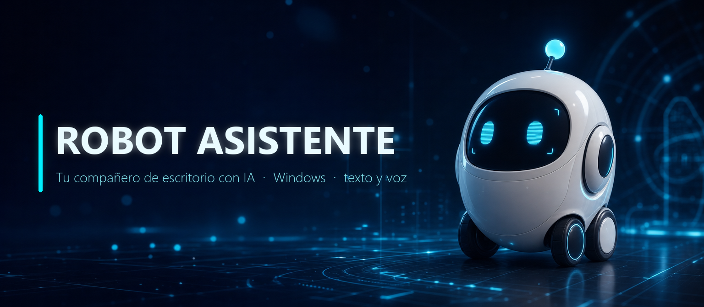
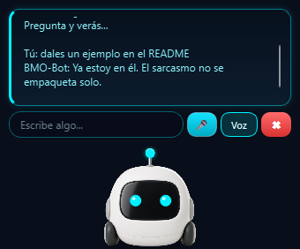

<p align="center">
  
</p>

# Robot Asistente

[](https://github.com/david-d2c2/ROBOT-ASISTENTE)
[](https://www.python.org/)
[](https://www.riverbankcomputing.com/software/pyqt/)
[](LICENSE)

**BMO-Bot** es un robot compañero que vive en tu escritorio de Windows: camina por la
parte inferior de la pantalla, conversa contigo por texto o por voz, y reacciona con sus
ojos luminosos y su antena a todo lo que pasa — escucha, piensa, habla o se equivoca.
Y sí, tiene **humor ácido**: te contesta con sorna, pero siempre te da lo que le pides.

<p align="center">
  
</p>

## ✨ Qué hace

- 🤖 **Personaje 3D** (render estilo Pixar generado con IA) con estados animados: reposo,
  paseo, escucha, pensamiento, habla y error. Al caminar se muestra **de perfil con las
  ruedas girando**, se para a mirarte de vez en cuando soltando una frase ácida (que
  **dice en voz alta**) y, al hacer clic, se gira de frente para atenderte. Tamaño
  ajustable con la rueda del ratón.
- 💬 **Multi proveedor de IA**: Z.AI (GLM), OpenAI, Gemini o modelos locales en tu PC
  (Ollama, LM Studio, llama.cpp).
- 🎛️ **Panel de ajustes con asistente inicial**: eliges proveedor, pegas tu clave y
  «Probar conexión» — sin tocar un `.env` a mano.
- 🧠 **Memoria de conversación** configurable, historial persistente opcional (SQLite)
  y botón para olvidarlo todo al instante. Además, **memoria de largo plazo**: dile
  «recuerda que...» y lo guardará en tu PC para futuras conversaciones.
- ⚡ **Streaming**: ves la respuesta mientras se genera, en un chat con burbujas, y el
  robot **la va diciendo frase a frase** conforme llega.
- 👂 **Manos libres**: activa "👂 Modo manos libres" en la bandeja y di "robot, abre la
  calculadora". Palabras de activación configurables (`WAKE_WORDS`); con dictado local
  (whisper) no tocas teclado ni ratón.
- 📷 **Visión**: captura cualquier región de la pantalla (botón 📷) y pregúntale lo que
  quieras: "¿qué error es este?", "resume esta pantalla", "lee el gráfico". Requiere un
  proveedor multimodal (Z.AI/GLM, OpenAI o Gemini) y un modelo con visión.
- 🛠️ **Acciones de escritorio con confirmación**: abrir apps (lista blanca), webs,
  recordatorios con notificación, notas y **pomodoro** con aviso al terminar.
- 🧩 **Habilidades locales**: suelta un JSON en la carpeta `skills/` con disparadores y
  respuesta, y el robot contestará al instante sin llamar a la IA (frases fijas, modos
  demo, atajos de personalidad).
- 🎤 **Voz**: habla y te responde en voz alta; atajo global de dictado (Ctrl+Alt+R);
  dictado con Google o **100 % local** (faster-whisper); 🔇 para callarlo sin perder
  la respuesta.
- 🖥️ **Integración Windows**: bandeja del sistema, instancia única, preferencias
  persistentes, multimonitor, cierre seguro y comprobador de actualizaciones.
- 🎭 **Personalidades**: humor ácido, normal o técnico, cambiables desde ajustes.
- 🎨 **Skins de color**: Clásico, Matrix, Neón o Solar — cambian ojos, antena, burbuja
  y botones al instante desde ⚙ Ajustes.
- 🎙️ **Selector de micrófono** y editor de apps permitidas en ⚙ Ajustes.
- 📤 **Exportar conversación** a Markdown desde el menú contextual.
- 🔄 **Auto-actualizador**: te ofrece descargar e instalar la nueva versión desde
  la propia app (ejecutable).
- ♿ **Movimiento reducido** disponible (`REDUCED_MOTION=1`) para pantallas sensibles.

## 📦 Instalación

### Opción A — Ejecutable (sin Python)

1. Descarga `RobotAsistente-win64.zip` desde la última
   [**Release**](https://github.com/david-d2c2/ROBOT-ASISTENTE/releases/latest).
2. Descomprímelo donde quieras (por ejemplo `C:\RobotAsistente`).
3. Doble clic en `RobotAsistente.exe`: **la primera vez se abre el asistente de
   configuración** — elige proveedor, pega tu clave y pulsa «Probar conexión».
   (Si prefieres el `.env` clásico, cópialo de `.env.example` junto al exe.)

> El antivirus o SmartScreen pueden avisar la primera vez porque el binario no está
> firmado: elige «Ejecutar igualmente».

### Opción B — Desde el código

Necesitas **Windows 10/11** y **Python 3.11 o superior**:

```powershell
git clone https://github.com/david-d2c2/ROBOT-ASISTENTE.git
cd ROBOT-ASISTENTE
py -3 -m venv .venv
.\.venv\Scripts\python.exe -m pip install -r requirements.txt
Copy-Item .env.example .env    # y edita .env con tu clave de API
.\.venv\Scripts\python.exe main.py
```

Acceso directo con icono en el escritorio:

```powershell
powershell -ExecutionPolicy Bypass -File .\crear_acceso_directo.ps1
```

## 🔑 Configura tu proveedor (`.env`)

Solo hay que elegir **un** proveedor con `AI_PROVIDER`:

| Proveedor | `.env` |
|---|---|
| **Z.AI (GLM)** | `AI_PROVIDER=zai` · `ZAI_API_KEY=...` · `ZAI_MODEL=glm-4.6` |
| **OpenAI** | `AI_PROVIDER=openai` · `OPENAI_API_KEY=...` · `OPENAI_MODEL=gpt-4.1` |
| **Gemini** | `AI_PROVIDER=gemini` · `GEMINI_API_KEY=...` · `GEMINI_MODEL=...` |
| **Ollama** (local) | `AI_PROVIDER=ollama` · `LOCAL_LLM_MODEL=llama3.2` |
| **LM Studio** (local) | `AI_PROVIDER=lmstudio` |
| **llama.cpp** (local) | `AI_PROVIDER=llamacpp` · `LOCAL_CHAT_URL=http://127.0.0.1:8080/v1/chat/completions` |

Todo esto (y más) se puede configurar desde **⚙ Ajustes** sin editar archivos.
Variables extra: `PERSONA` (acido · normal · tecnico), `CHAT_HISTORY_TURNS` (memoria),
`HOTKEY` (atajo global de dictado), `REDUCED_MOTION` (menos animación),
`ZAI_BASE_URL` (plan de código de Z.AI). Ver `.env.example` completo.

## 🗣️ Voz y dictado

- **Respuestas habladas** con dos motores:
  - **Edge TTS** (Internet, por defecto): `TTS_VOICE`, `TTS_RATE`, `TTS_PITCH`.
  - **Piper local, sin conexión**: `TTS_PROVIDER=piper` y
    `pip install -r requirements-tts.txt`. La voz `es_ES-davefx-medium` se
    descarga sola la primera vez (~65 MB) y luego funciona offline. Cambiable
    desde ⚙ Ajustes.
- **Dictado**: Google por defecto, o **100 % local** con
  [faster-whisper](https://github.com/SYSTRAN/faster-whisper):

  ```powershell
  .\.venv\Scripts\python.exe -m pip install -r requirements-whisper.txt
  ```

  ```env
  STT_PROVIDER=whisper
  STT_LANGUAGE=es-ES
  WHISPER_MODEL=base
  ```

  El modelo se descarga solo la primera vez (~75 MB para `base`) y luego funciona sin conexión.

## 🕹️ Uso

- **Clic en el robot**: muestra u oculta los controles. Escribe y pulsa Enter, o pulsa 🎤
  (o el **atajo global Ctrl+Alt+R**, configurable con `HOTKEY`).
- **⏹** cancela la consulta; durante el habla se convierte en **🔇** (callar, la respuesta
  queda escrita). **Arrastrar** lo coloca donde quieras; camina solo.
- **Rueda del ratón** sobre el robot: lo hace más grande o pequeño.
- **Clic derecho**: controles, olvidar conversación, copiar respuesta, ajustes y apagar.
- **✖** lo oculta en la bandeja del sistema; desde la bandeja también se apaga, se abren
  los ajustes y se buscan actualizaciones.
- Si pulsas el acceso directo con el robot ya abierto, aparece y se pone delante.
- Pídele acciones en lenguaje natural: «abre la calculadora», «recuérdame en 10 min la
  ropa», «abre github.com» — siempre te pedirá confirmación antes de ejecutar.

## 🔒 Privacidad

- Sin cuentas ni telemetría: el robot habla con el proveedor de IA que **tú** configuras.
- La conversación vive en memoria, nunca en disco; «Olvidar conversación» la borra.
  Los recuerdos de largo plazo («recuerda que...») sí se guardan en tu PC (SQLite en
  AppData) y «🧠 Olvidar lo que sabe de mí» los elimina al instante.
- El micrófono solo se activa cuando lo pides; con `STT_PROVIDER=whisper` el audio
  no sale de tu equipo.
- Tus claves viven en `.env`, que nunca se incluye en el repo ni en el ejecutable.

## 🧪 Tests y empaquetado

```powershell
# Tests (127) sin abrir ventanas
$env:QT_QPA_PLATFORM="offscreen"
.\.venv\Scripts\python.exe -m unittest discover -s tests -v

# Empaquetar tu propio ejecutable (PyInstaller)
.\build_exe.bat    # genera dist\RobotAsistente\RobotAsistente.exe
```

Arquitectura, decisiones e historial de fases en [PROYECTO.md](PROYECTO.md).

## 📄 Licencia

[MIT](LICENSE) — úsalo, modifícalo y compártelo. El render 3D del personaje fue
generado con un modelo de imagen por IA a partir del diseño del propio proyecto.
